<p align="center">


</p>

# ResilientThreatStream

**Real-time network threat analytics that survives data loss.**
Kafka → Spark Structured Streaming (rules + MLlib) → **sharded & replicated MongoDB** + **Parquet data lake** → Streamlit SOC dashboard, with verified backups and one-command data-loss simulation and recovery.

*Big Data Analytics (26ECSC404) course project · KLE Technological University*

| | |
|-|-|
| **Dataset** | CIC-IDS2017 payload variant: 1,410,255 records, 1,505 columns (4 header fields, 1 label, 1,500 payload bytes) |
| **Stack** | Apache Kafka 4.3.1 (KRaft) · Apache Spark 3.5.6 (Structured Streaming, MLlib, SQL) · MongoDB 8.0.4 (sharded) · Parquet · Streamlit |
| **Focus** | Data-loss handling and backup using Big Data storage concepts: sharding, replication, immutable lake, snapshots |
| **Tests** | 108 unit/integration tests pass |

---

## Contents
1. [The problem and the idea](#1-the-problem-and-the-idea)
2. [Architecture](#2-architecture)
3. [Results (all measured)](#3-results-all-measured)
4. [Repository layout](#4-repository-layout)
5. [Installation](#5-installation)
6. [Run the demo (step by step)](#6-run-the-demo-step-by-step)
7. [The three data-loss scenarios](#7-the-three-data-loss-scenarios)
8. [Dashboard](#8-dashboard)
9. [Configuration](#9-configuration)
10. [Tests](#10-tests)
11. [Streamlit Cloud deployment](#11-streamlit-cloud-deployment)
12. [Lesson-plan concept mapping](#12-lesson-plan-concept-mapping)
13. [Limitations](#13-limitations)
14. [More documentation](#14-more-documentation)

---

## 1. The problem and the idea

The first version of this project was a working one-way pipeline (CSV → Kafka → Spark → one MongoDB → dashboard) with five weaknesses:

| | Weakness | Fix in this repo |
|-|----------|------------------|
| A | **One database, no copy of anything**: a crash, a `DROP DATABASE` or a lost disk destroys all results (the mentor's main concern) | Sharding + replication, Parquet data lake, verified backups, lake-based recovery |
| B | Single Kafka partition (~6,380 rec/s ceiling) | 4 partitions, keyed routing |
| C | Detector used 4 of 1,505 columns; 0% recall on several application-layer attacks | Spark MLlib PCA(32) + Random Forest on the 1,500 payload bytes |
| D | No batch layer | Spark SQL over the lake (tumbling and sliding windows) |
| E | No disaster-recovery procedure | `backup_manager.py`, DR drill, data-loss simulation |

**Why sharding *and* replication (not a replica set alone)?** They solve different problems. A replica set has one primary that takes all writes and every node stores all the data: it survives a server crash but cannot split writes or data. Sharding splits both. A production shard is itself a replica set, so we use **2 shards × 3 replicas behind a `mongos` router**. Neither protects against deletion (replicas copy a mistaken delete instantly), so snapshots and the lake exist as well. Full reasoning: [docs/PROJECT_EXPLAINED.md](docs/PROJECT_EXPLAINED.md).

## 2. Architecture

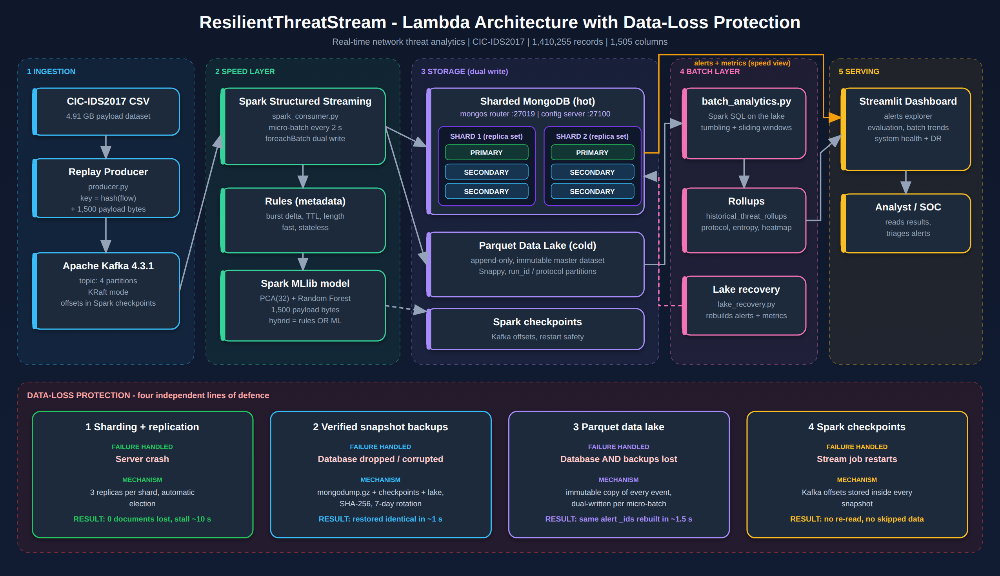

*Lambda architecture: every micro-batch is written twice (hot sharded MongoDB, cold Parquet lake); four independent defences protect against data loss.*

Sharded cluster detail:


```
 clients ──► mongos :27019 ──► config server :27100
                 ├─► shard1 (replica set): :27111 :27112 :27113   (1 PRIMARY + 2 SECONDARY)
                 └─► shard2 (replica set): :27121 :27122 :27123
 shard key threat_alerts = {_id: hashed}  ·  historical_threat_rollups = {run_id, rollup_type}
```

**Four lines of defence**

| # | Defence | Failure it handles |
|---|---------|--------------------|
| 1 | Sharding + replication (automatic election) | A database **server crashes** |
| 2 | Verified snapshot backups | The database is **deleted or corrupted** |
| 3 | Parquet data lake (dual-written per micro-batch) | **Database and all backups lost** |
| 4 | Spark checkpoints archived in every snapshot | Streaming job restart without re-reading or skipping data |

The detector never sees the ground-truth `label` (tests enforce this); labels are used only for offline evaluation.

## 3. Results (all measured)

**Detection, full dataset (1,410,255 records)**

| Detector | Precision | Recall | F1 | FPR |
|----------|-----------|--------|----|-----|
| Baseline metadata rules | 98.28% | 67.67% | 80.15% | 3.43% |
| Hybrid (rules OR MLlib) | 98.25% | **99.85%** | **99.04%** | 5.15% |

Trade-off: recall rises, FPR rises from 3.43% to 5.15%. PCA(32) keeps 74.2% of variance; the model was trained on a 10k sample; CIC-IDS2017 attacks are very separable, so live traffic would score lower.

**Data-loss scenarios (`make data-loss-demo`, run `demo-run`: 12,000 events, 9,089 alerts)**

| Scenario | Destroyed | Recovery | Result |
|----------|-----------|----------|--------|
| A | `kill -9` on a shard primary | Automatic election | 60/60 writes accepted, stall ≈ 10 s, 0 documents lost |
| B | Whole database dropped | Verified snapshot + `mongorestore` | Identical counts, RTO ≈ 1 s |
| C | Database **and** all snapshots deleted | Rebuild from the Parquet lake | Same 9,089 alert `_id`s, ≈ 1.2-1.6 s |

**Sharding:** 188,683 / 188,642 documents per shard (max/min = 1.0); `_id` lookup contacts 1 shard, `run_id` filter 2. **Kafka:** 1 → 4 partitions raised ingestion 9,635 → 12,889 rec/s (+34%) on this laptop; the 20,000 rec/s target was **not** reached. **Parquet vs CSV:** 3.98× smaller, ~11× faster single-column scan.

Both shards run on one laptop, so sharding demonstrates distribution, routing and failover, not a throughput gain. Details and caveats: [docs/LAMBDA_ARCHITECTURE_AND_BDA_CONCEPTS.md](docs/LAMBDA_ARCHITECTURE_AND_BDA_CONCEPTS.md).

## 4. Repository layout

```
.
├── producer.py              Kafka replay producer (--key-by, --include-payload)
├── spark_consumer.py        Structured Streaming job: detector + dual-write sinks
├── threat_detector.py       Metadata heuristic rules
├── ml_payload_detector.py   MLlib PCA + RandomForest, hybrid logic, benchmark CLI
├── mongo_sink.py            Idempotent MongoDB upserts (works through mongos)
├── lake_sink.py             Parquet data-lake writer (Snappy, run_id/protocol partitions)
├── batch_analytics.py       Batch layer: Spark SQL rollups from the lake
├── evaluate_rules.py        Offline evaluation of the baseline rules
├── dashboard.py / dashboard_utils.py   Streamlit SOC dashboard
├── scripts/                 Operations: install, start, shard cluster, backup, recovery, demo
├── tests/                   108 unit/integration tests
├── tools/                   Dataset helpers (sampling, validation, inspection)
├── models/payload_rf/       Trained MLlib pipeline used by the demo
├── docs/                    Explanation, demo guide, architecture references, benchmarks
├── presentation/            PowerPoint (14 slides)
├── report/                  LaTeX report sources + Project_Report.pdf
├── screenshots/             Dashboard images
├── Makefile                 Short commands (make help)
└── archive/                 Old material, git-ignored (never pushed)
```

`data/` (datasets), `data/lake/`, `backups/`, `checkpoints/` and virtual environments are git-ignored: they are generated or too large.

## 5. Installation

Tested on Ubuntu 26.04 (works on 22.04+), 8 cores, **7.5 GB RAM**. Close other heavy applications first: the sharded cluster, Kafka and Spark share that memory.

```bash
git clone git@github.com:HarshaNaik8/BDA.git && cd BDA
scripts/install_services.sh      # Java 17, Python 3.11 venv (.venv311), Kafka 4.3.1, MongoDB 8.0.4 + tools in ~/bigdata-tools
```

PySpark 3.5.6 needs Python ≤ 3.12 (Python 3.11 is used). MongoDB and Kafka run user-space, so no systemd is needed.

**Dataset.** Download CIC-IDS2017 *Payload_data_CICIDS2017.csv* (4.91 GB) and place it next to the repo, then create the two small replay samples used by the demo (they are git-ignored):

```bash
.venv311/bin/python tools/prepare_stream_sample.py --input ../Payload_data_CICIDS2017.csv --output data/stream_sample_10k.csv --rows 10000 --seed 42
.venv311/bin/python tools/prepare_stream_sample.py --input ../Payload_data_CICIDS2017.csv --output data/eval_sample_30k.csv   --rows 30000 --seed 2024
```

The trained model is in `models/payload_rf/`. To retrain: `make train`.

## 6. Run the demo (step by step)

The complete 25-minute presentation script (what to run, what to show, what to say, expected output) is **[docs/DEMO_GUIDE.md](docs/DEMO_GUIDE.md)**. Summary:

**0. Start everything and reset the demo data** (demo-only DB `bda_demo`; real data is never touched)
```bash
scripts/start_services.sh      # standalone mongod, sharded cluster (7 nodes + mongos), Kafka, 4-partition topics
scripts/reset_demo.sh
```
In **every** terminal: `source scripts/demo_env.sh` (points the pipeline at `mongos` and the demo names).

**1. Show the infrastructure** (Terminal 1)
```bash
make shards-status             # 2 shards x 3 replicas, one PRIMARY each, config server, docs per shard
```

**2. Dashboard** (Terminal 3): `streamlit run dashboard.py` → http://localhost:8501 (empty at first).

**3. Spark consumer** (Terminal 2, start first; needs ~25 s to attach)
```bash
"$SPARK_HOME/bin/spark-submit" --driver-memory 2g \
  --packages org.apache.spark:spark-sql-kafka-0-10_2.12:3.5.6 spark_consumer.py \
  --topic "$KAFKA_TOPIC" --starting-offsets earliest --checkpoint-dir "$CHECKPOINT_DIR" --run-id demo-run \
  --ml-model models/payload_rf --max-offsets-per-trigger 10000 --trigger-interval "2 seconds" \
  --await-termination-timeout 150
```

**4. Produce data** (Terminal 1) → watch Terminal 2 print every micro-batch (rules-only baseline vs hybrid confusion matrix, `[MongoDB] persisted`, `[Lake] Appended`)
```bash
python producer.py --input data/eval_sample_30k.csv --limit 12000 --topic "$KAFKA_TOPIC" --delay 0 --key-by flow --include-payload
```

**5. Batch layer and a verified backup**
```bash
python batch_analytics.py --lake-dir data/lake --run-id demo-run --window "10 seconds"
python scripts/backup_manager.py run --lake-dir data/lake --checkpoint-dir "$CHECKPOINT_DIR" --backup-dir "$BACKUP_DIR"
```
Refresh the dashboard: 12,000 records, 9,089 alerts, batch trends, system health (backup verified, Kafka lag 0, shard table).

**6. Simulate data loss** (next section). Non-interactive one-shot version of steps 3-5: `bash scripts/run_lambda_demo.sh`.

### What you should see at each step (real screenshots)

Terminal images below are rendered from the captured output of an actual run (`scripts/` + the commands above); dashboard images are real browser captures.

| Step | What it shows and how to read it |
|------|----------------------------------|
| 1. Cluster | 2 shards x 3 replicas, one PRIMARY per shard, config server; `threat_alerts` split between shards (`balance max/min` close to 1.0 = even) |
| 2. Kafka | `PartitionCount: 4` |
| 3. Producer | `Records acknowledged: 12,000`, `Records failed: 0`, key strategy `flow` |
| 4. Spark | Per micro-batch: rule alerts, rules-only baseline (note the many FN), hybrid confusion matrix (few FN), `[MongoDB] persisted` and `[Lake] Appended` = the dual write |
| 5. Batch + backup | rollups built from the lake; `[Verify] ... OK` = SHA-256 and archive checks passed; alerts per shard |
| 6. Dashboard | overview cards, evaluation, batch analytics, system health |

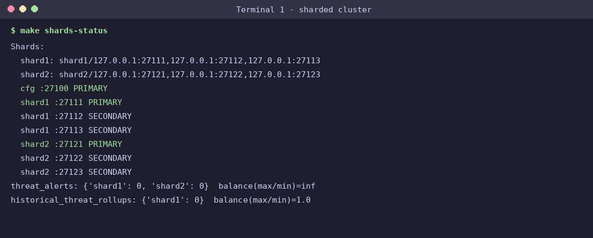
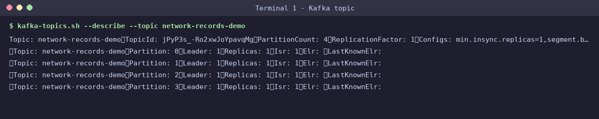
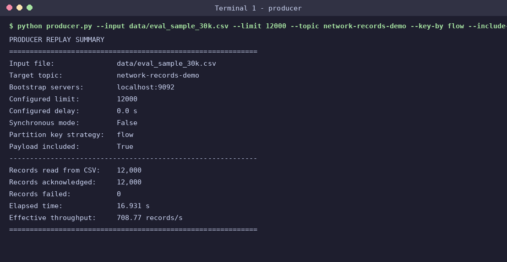
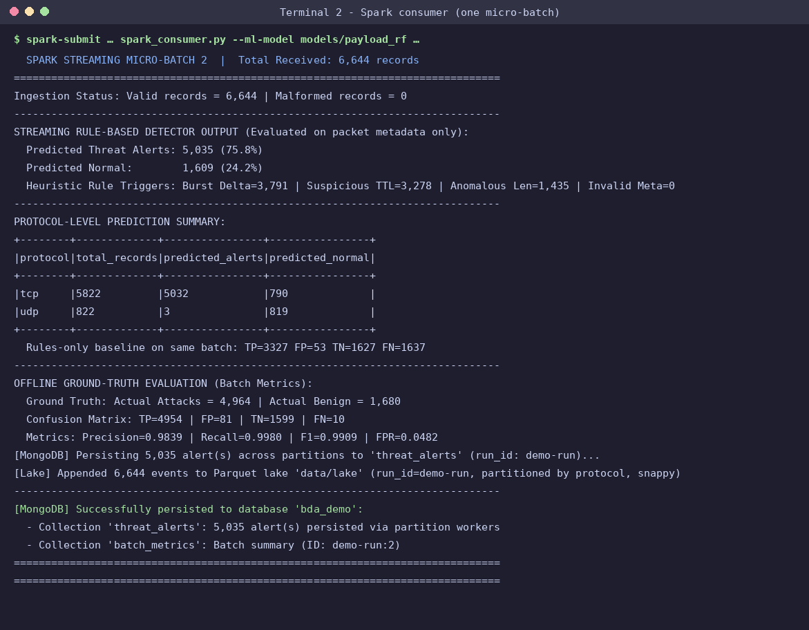
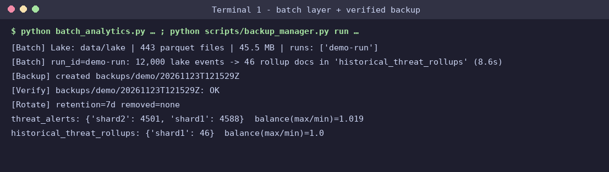

**Dashboard overview** (12,000 records, 9,089 alerts):
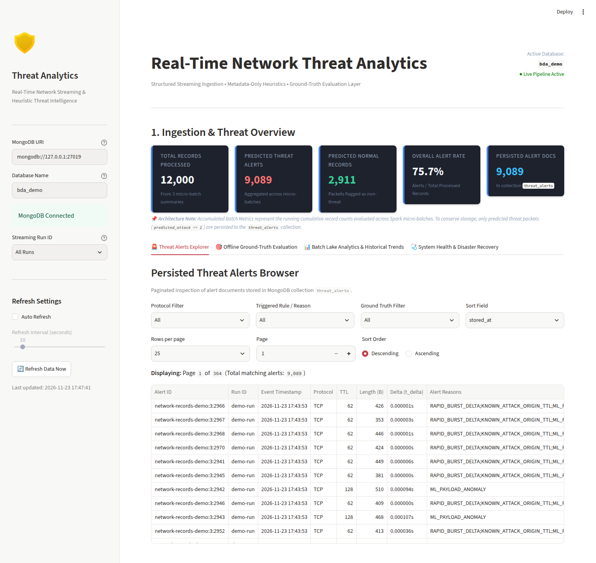

**Offline ground-truth evaluation** (confusion matrix and metrics; labels used only here):
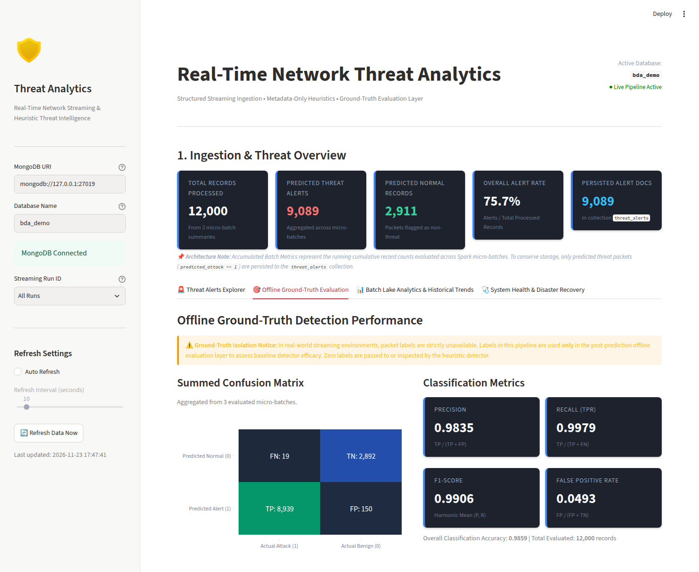

**Batch lake analytics** (tumbling vs sliding windows, entropy, attack-family detection, heatmap):
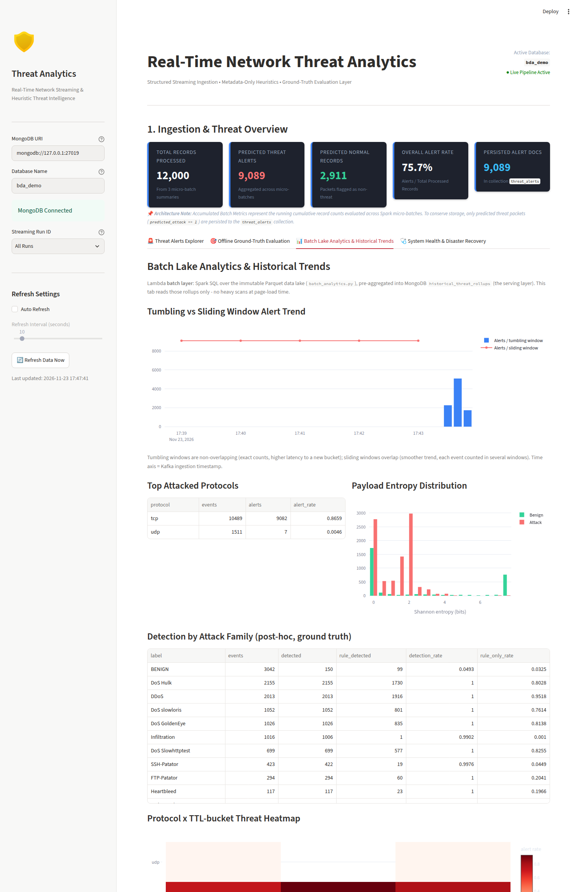

**System health and disaster recovery** (last backup verified, lake size, Kafka lag 0, shard roles):
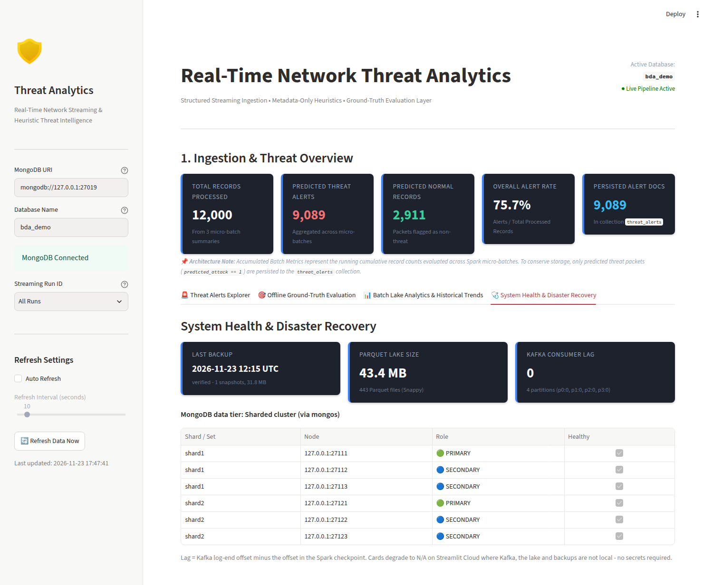

## 7. The three data-loss scenarios

```bash
python -m scripts.data_loss_demo --mongo-db "$MONGODB_DATABASE" --checkpoint-dir "$CHECKPOINT_DIR" --backup-dir "$BACKUP_DIR" --pause
```
`--pause` waits for Enter before each destructive step so you can explain it. Keep the dashboard's **System Health** tab open and refresh after each step.

| Scenario | You will see | Concept |
|----------|--------------|---------|
| **A** server crash | `kill -9` on a shard primary → `60/60 probe writes accepted`, `NO DATA LOST`, node restarts and re-syncs | Replication, election |
| **B** database dropped | `documents now: {}` → restore → `IDENTICAL`, RTO ≈ 1 s | Snapshot backup, RPO/RTO |
| **C** database + backups deleted | `snapshots: 0` → rebuild → `same _ids as before: True` | Lambda master dataset |

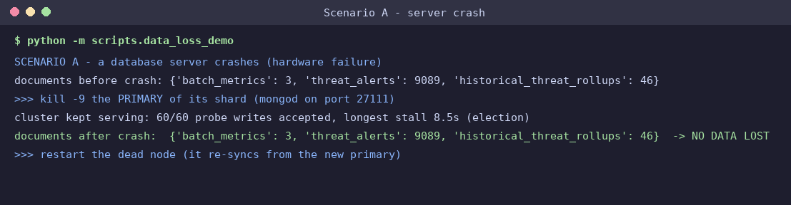
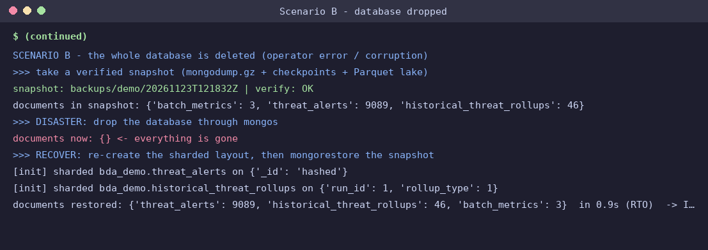
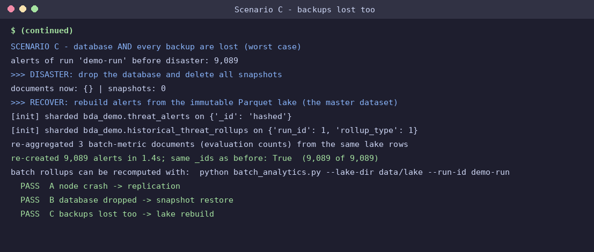

How to read them: **A** `NO DATA LOST` = the document counts before and after the crash are equal; **B** `documents now: {}` proves the database is really gone, `IDENTICAL` proves the restore; **C** `snapshots: 0` proves the backups are gone too, `same _ids as before: True` proves the lake rebuilt exactly the same alerts.

Afterwards recompute the batch views (`python batch_analytics.py --lake-dir data/lake --run-id demo-run`). Extras: `make shard-demo` (distribution, routing, primary step-down under load) and `make drill` (backup → restore to scratch DB → compare).

What scenario C cannot restore (stated honestly): per-rule reason text of each alert (the lake stores rule/ML verdicts), original batch timestamps, malformed-record counts.

## 8. Dashboard

Four tabs: **Threat Alerts Explorer** (filter/page alerts), **Offline Ground-Truth Evaluation** (confusion matrix, precision/recall/F1; labels used only here), **Batch Lake Analytics** (tumbling vs sliding windows, protocol table, payload-entropy histogram, attack-family detection, TTL heatmap, CSV-vs-Parquet study) and **System Health & Disaster Recovery** (last backup and verification state, lake size, Kafka lag per partition, node role and health of every shard).

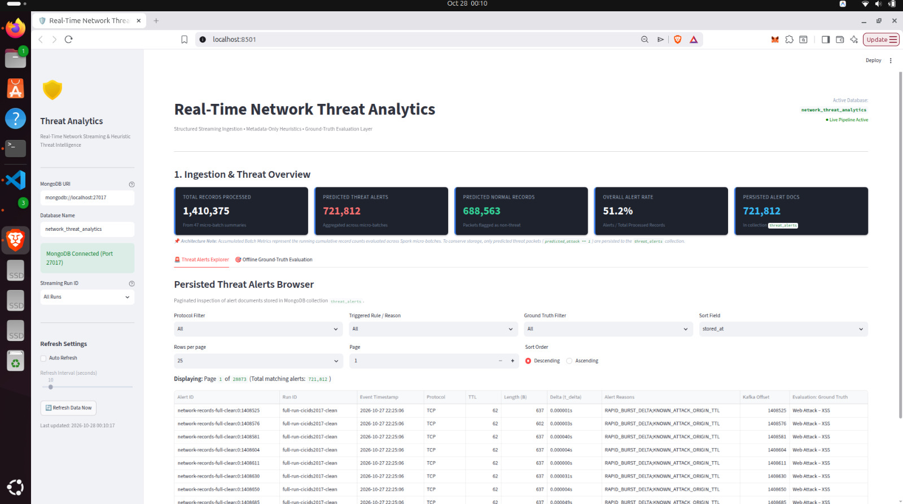

(Original dashboard captures; the four tabs are shown with the current data in section 6.)

## 9. Configuration

Settings resolve in this order: Streamlit `st.secrets` → environment variable → local default. No credentials are stored in the repo. Copy `.env.example` as a reference.

| Variable | Default | Meaning |
|----------|---------|---------|
| `MONGODB_URI` | `mongodb://localhost:27017` (demo: `mongodb://127.0.0.1:27019`) | Standalone server or the `mongos` router |
| `MONGODB_DATABASE` | `network_threat_analytics` (demo: `bda_demo`) | Database name |
| `KAFKA_BOOTSTRAP`, `KAFKA_TOPIC` | `localhost:9092`, `network-records-multi` | Used by the dashboard lag card |
| `CHECKPOINT_DIR`, `LAKE_DIR`, `BACKUP_DIR` | `checkpoints/stage8_lambda`, `data/lake`, `backups` | Health tab sources |

## 10. Tests

```bash
make test        # = .venv311/bin/python -m unittest discover -s . -p "test_*.py"   (108 tests)
```
Tests that need MongoDB skip themselves when it is not running. Covered: rules, sinks, Parquet lake, keyed routing, ML (including "label is never a model input"), batch analytics, backups (corruption detection, rotation, restore), sharding configuration, lake recovery, dashboard helpers.

## 11. Streamlit Cloud deployment

The dashboard needs only `requirements.txt` and a MongoDB Atlas URI in the app's secrets (`MONGODB_URI`, `MONGODB_DATABASE`); the lake, backup and Kafka cards show "N/A" there because those are local. Migrate data with `mongodump`/`mongorestore` (or `scripts/backup_manager.py`) and allow Streamlit's IPs in Atlas.

## 12. Lesson-plan concept mapping

| Course topic (Lesson Plan) | Where |
|----------------------------|-------|
| Sharding, replication, combining both; NoSQL document store | `scripts/sharded_cluster.sh`, `shard_setup.py`, shard keys |
| On-disk vs in-memory storage; columnar formats (RCFile → Parquet) | `lake_sink.py`, Spark cache, CSV-vs-Parquet benchmark |
| Parallel/distributed processing, MapReduce, Spark | partitioned Kafka, `groupBy` aggregations, per-partition writers, MLlib |
| Batch vs stream, Lambda architecture, sources/sinks, immutable streams | speed/batch/serving layers, append-only lake, idempotent upserts |
| Tumbling and sliding windows; stateless vs stateful | `batch_analytics.py`, rule detector (stateless) vs windows (stateful) |
| Hive/HQL-style analysis | Spark SQL over Parquet |
| Visualisation | dashboard tabs |

## 13. Limitations

* Everything runs on one machine and one disk: the cluster proves distribution, routing and failover, **not** throughput gain or protection against losing the machine. A real deployment needs separate hosts and an off-site copy of `backups/` and the lake.
* Failover stall ≈ 10 s (election timeout); the 20,000 rec/s ingestion target was not reached on this laptop.
* No point-in-time recovery between snapshots; Kafka itself has replication factor 1.
* The hybrid detector raises FPR (5.15%); the model is trained on a small sample from a highly separable dataset.
* Spark MLlib is CPU-only; the laptop's GPU is not used.
* The lake keeps payload *statistics* (entropy, mean, non-zero count), not the 1,500 raw bytes.

## 14. More documentation

| File | Purpose |
|------|---------|
| [docs/PROJECT_EXPLAINED.md](docs/PROJECT_EXPLAINED.md) | Plain-language explanation, design decisions, likely mentor questions |
| [docs/DEMO_GUIDE.md](docs/DEMO_GUIDE.md) | Full live-demo script with expected output and troubleshooting |
| [docs/SHARDING_AND_BACKUP_ARCHITECTURE.md](docs/SHARDING_AND_BACKUP_ARCHITECTURE.md) | Shard keys, protections, measured RPO/RTO |
| [docs/LAMBDA_ARCHITECTURE_AND_BDA_CONCEPTS.md](docs/LAMBDA_ARCHITECTURE_AND_BDA_CONCEPTS.md) | Lambda layers, benchmarks, concept mapping |
| [presentation/](presentation/) | 14-slide deck |
| [report/Project_Report.pdf](report/Project_Report.pdf) | Project report (LaTeX sources alongside) |

**Authors:** Harsha Naik and team (edit before submission). **Guide:** to be added.
