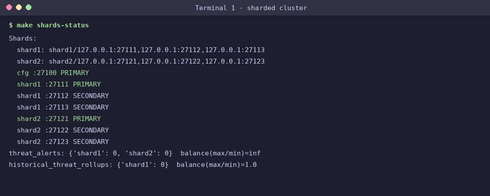
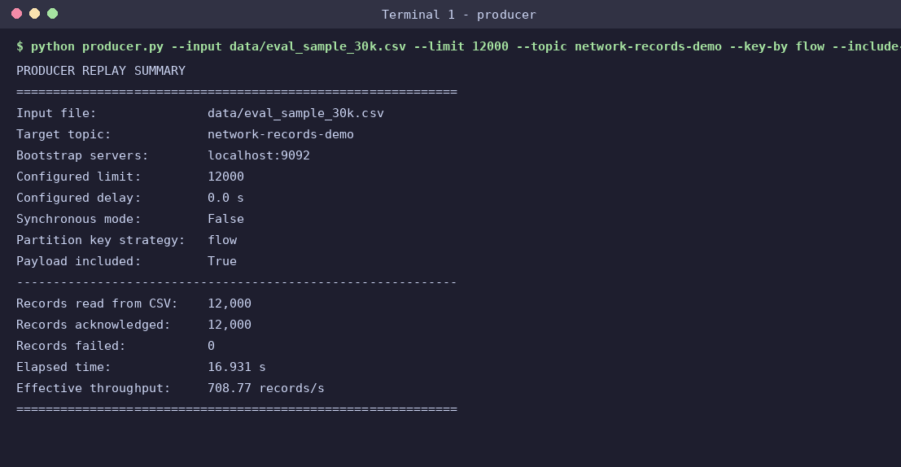
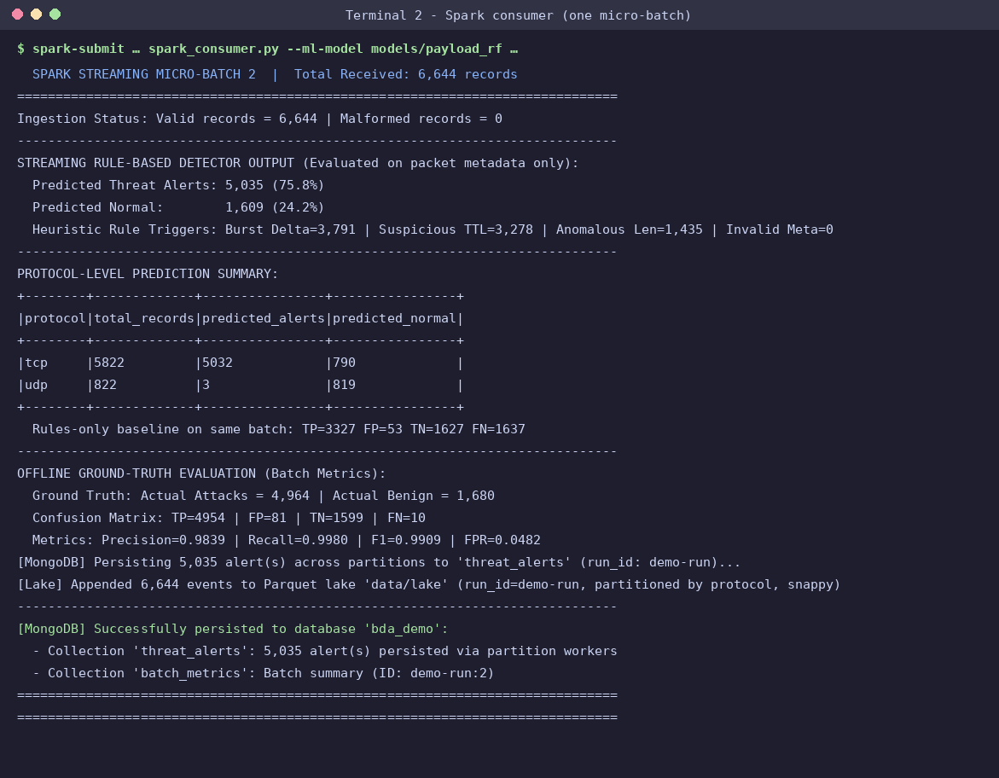
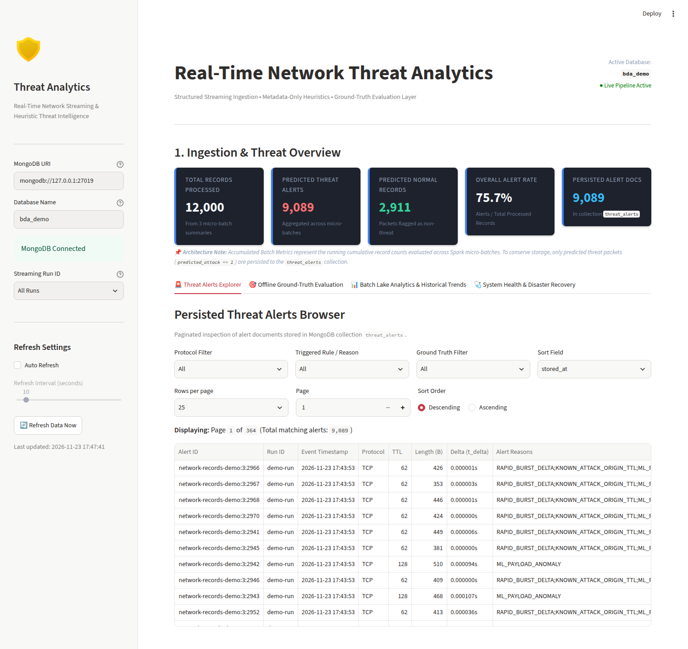
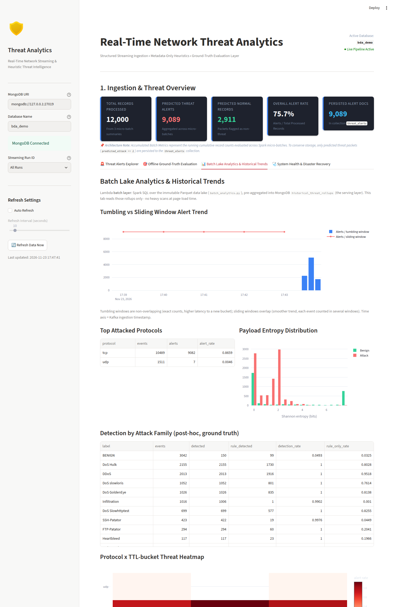
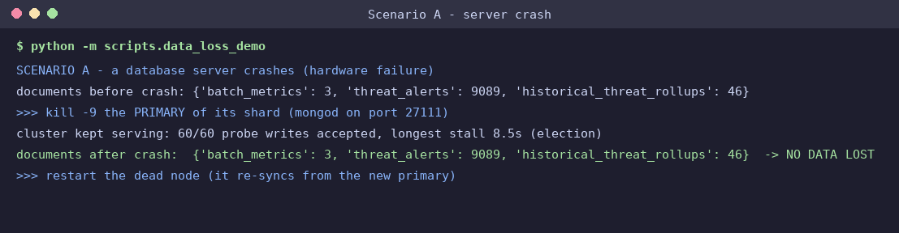
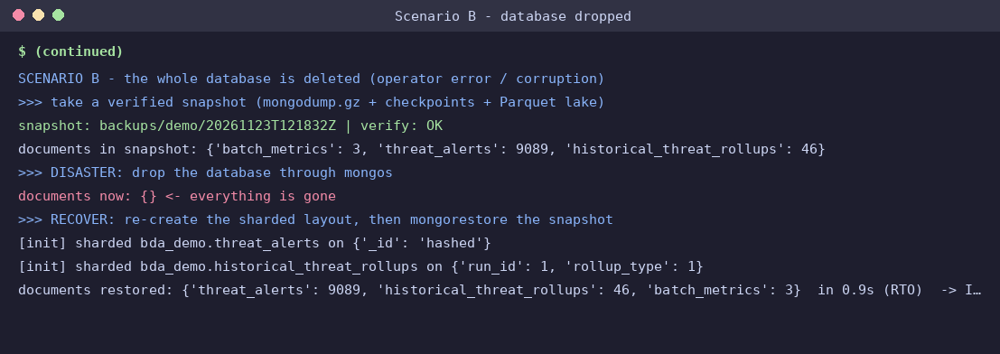
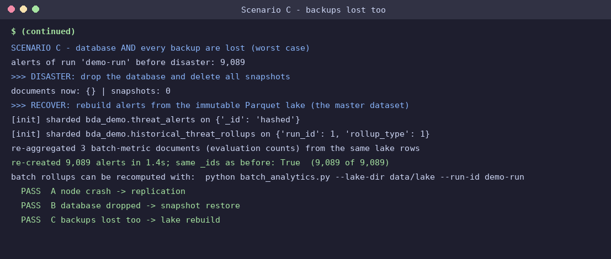

# Live Demo Guide (about 25 minutes)

Goal: show the whole workflow end to end, then **destroy data on purpose** and show it come back, with the dashboard and the terminal side by side.
Every command below was run on this laptop; the expected output is what you should see (numbers are from a real run).

## 0. Before the mentor arrives (10 minutes)

RAM is tight (7.5 GB). **Close Chrome tabs and other apps first.** Then:

```bash
cd "/mnt/shared/Shared/Documents/4th_year/BDA/course project/network_threat_analytics_starter"
scripts/start_services.sh          # standalone mongod, sharded cluster (7 nodes + mongos), Kafka, 4-partition topics
scripts/reset_demo.sh              # clean slate: ONLY demo data is removed (topic network-records-demo, DB bda_demo, run demo-run)
```
You should end with a table of 3 shard1 nodes, 3 shard2 nodes, `cfg` and `threat_alerts` balance. If a command hangs, run `make shards-status`.
Rehearse once with `bash scripts/run_lambda_demo.sh` (about 2 minutes), then `scripts/reset_demo.sh` again.

**Screen layout** (3 terminals + browser, all in the project folder; in *every* terminal run `source scripts/demo_env.sh`):

| Window | Purpose |
|--------|---------|
| Terminal 1 | commands you type (producer, status, backups, disasters) |
| Terminal 2 | Spark consumer (live micro-batch log) |
| Terminal 3 | dashboard server: `streamlit run dashboard.py` |
| Browser | `http://localhost:8501` |

---

## 1. Show the architecture (2 min)
Open the slide deck (`course_materials/Real_Time_Network_Threat_Analytics_Project.pptx`, slides 5, 7, 8). Say: *"Mentor's concern was data loss. Four layers of protection: sharding with replication, snapshots, a Parquet lake, and Spark checkpoints."*

## 2. Show the infrastructure is real (3 min)
Terminal 1:
```bash
make shards-status
```


**See:** `Shards: shard1/…27111,27112,27113`, `shard2/…27121,27122,27123`, one PRIMARY and two SECONDARY per shard, config server. **Say:** *"Two shards, each a replica set of three copies; `mongos` on 27019 is the only address the pipeline knows."*
```bash
~/bigdata-tools/kafka_2.13-4.3.1/bin/kafka-topics.sh --bootstrap-server localhost:9092 --describe --topic network-records-demo
```
**See:** `PartitionCount: 4`. **Say:** *"Kafka is split into 4 partitions, so Spark reads in parallel."*

## 3. Start the dashboard (1 min)
Terminal 3:
```bash
source scripts/demo_env.sh && streamlit run dashboard.py
```
Open `http://localhost:8501`: it says "No streaming data found". That is correct, the database is empty.

## 4. Normal workflow: stream the data (5 min)
Terminal 2 (start Spark **first**, it needs ~25 s to attach):
```bash
source scripts/demo_env.sh
"$SPARK_HOME/bin/spark-submit" --driver-memory 2g \
  --packages org.apache.spark:spark-sql-kafka-0-10_2.12:3.5.6 spark_consumer.py \
  --topic "$KAFKA_TOPIC" --starting-offsets earliest --checkpoint-dir "$CHECKPOINT_DIR" --run-id demo-run \
  --ml-model models/payload_rf --max-offsets-per-trigger 10000 --trigger-interval "2 seconds" \
  --await-termination-timeout 150
```
Terminal 1 (when Spark prints `Query started`):
```bash
python producer.py --input data/eval_sample_30k.csv --limit 12000 --topic "$KAFKA_TOPIC" --delay 0 --key-by flow --include-payload
```
 

**See in Terminal 1:** `Records acknowledged: 12,000`, `Partition key strategy: flow`.
**See in Terminal 2**, per micro-batch: `Ingestion Status`, `Rules-only baseline on same batch`, the confusion matrix, `[MongoDB] Successfully persisted`, and `[Lake] Appended N events to Parquet lake`.
**Say:** *"Every micro-batch is written twice: alerts to the sharded MongoDB, every event to the Parquet lake. The rules alone miss about a third of attacks; the ML stage reads the 1,500 payload bytes and finds them (recall 67.7% to 99.8%)."*

After it finishes, Terminal 1:
```bash
python batch_analytics.py --lake-dir data/lake --run-id demo-run --window "10 seconds"
python scripts/backup_manager.py run --lake-dir data/lake --checkpoint-dir "$CHECKPOINT_DIR" --backup-dir "$BACKUP_DIR"
make shards-status | tail -3
```
**See:** `12,000 lake events -> 46 rollup docs`, `[Verify] ... OK`, and `threat_alerts: {'shard1': ~4,5xx, 'shard2': ~4,5xx}`.
**Say:** *"The batch layer re-analysed the lake. The snapshot was verified by checksum. Alerts are balanced across both shards by the hashed key."*

## 5. Show the dashboard (3 min)
Refresh the browser (the sidebar "Streaming Run ID" is `All Runs`):
* Overview cards: 12,000 records, **9,089 alerts**, 3-4 micro-batches (depends on timing).
  
* **Offline Ground-Truth Evaluation** tab: hybrid precision/recall (labels used only here).
* **Batch Lake Analytics** tab: tumbling vs sliding windows, entropy histogram, attack-family detection.
* 
* **System Health & Disaster Recovery** tab: last backup time and *verified*, lake size, **Kafka lag 0** on 4 partitions, and the **sharded cluster table** (every node and its role).

## 6. Simulate data loss, one disaster at a time (8 min)
Keep the browser on the **System Health** tab. Terminal 1:
```bash
python -m scripts.data_loss_demo --mongo-db "$MONGODB_DATABASE" --checkpoint-dir "$CHECKPOINT_DIR" --backup-dir "$BACKUP_DIR" --pause
```
`--pause` waits for Enter before each destructive step, so you can explain first.

| Scenario | You press Enter, then it... | Expected output | Say |
|----------|----------------------------|-----------------|-----|
| **A: server crash** | `kill -9` on a shard's primary `mongod` | `60/60 probe writes accepted, longest stall ~10 s`, `NO DATA LOST`, node restarted and re-synced | *"Replication: the two surviving copies elected a new primary. Nothing lost."* Refresh the dashboard: the node shows as down, then healthy again. |
| **B: database deleted** | takes a verified snapshot, **drops the whole database**, then restores | `documents now: {}` then `restored ... in ~1.1s (RTO) -> IDENTICAL` | *"Replicas copy a DROP instantly, so replication cannot help. The verified snapshot can."* Refresh: the dashboard is empty, then full again. |
| **C: database AND all backups deleted** | drops the DB and **deletes every snapshot**, then rebuilds from the lake | `snapshots: 0`, then `re-created 9,089 alerts in ~1.6s; same _ids as before: True` | *"The Parquet lake is the immutable master dataset (Lambda architecture), so even this worst case is recoverable."* |

Final lines: `PASS A…`, `PASS B…`, `PASS C…`.

Expected look (real captures):   

After scenario C, rebuild the batch views and refresh the dashboard:
```bash
python batch_analytics.py --lake-dir data/lake --run-id demo-run --window "10 seconds"
```
**Be upfront** (it builds trust): scenario C restores alerts and metrics but not the per-rule reason text, original batch timestamps or malformed-record counts; and everything is on one machine, so a real deployment would also copy `backups/` and the lake off-site.

## 7. Bonus: shard distribution and failover under load (optional, 2 min)
```bash
python -m scripts.shard_demo --failover
```
**See:** `{'shard2': 188683, 'shard1': 188642} balance(max/min)=1.0`, `_id equality -> shards contacted: 1 (targeted)`, `run_id filter -> shards contacted: 2 (scatter-gather)`, and `0 transient errors` during a primary step-down.

## 8. Wrap-up lines
* *"The original system had one database and no copy. Now a server crash, a deleted database and even deleted backups are each survivable, and each is demonstrated."*
* *"Sharding gives scale-out and replication gives availability; backups and the lake give recovery from mistakes."*
* Open `docs/PROJECT_EXPLAINED.md` section 8 for likely questions.

---

## Troubleshooting

| Problem | Fix |
|---------|-----|
| Machine is slow / swapping | Close the browser tabs and apps; stop the optional full-scale experiment; `free -m` should show >2 GB available |
| `Connection refused` on 27019 | `scripts/start_services.sh` (idempotent) then `make shards-status` |
| Spark: `find-spark-home` error | You skipped `source scripts/demo_env.sh` (it sets `SPARK_HOME` because the folder path contains spaces) |
| Dashboard shows another database | Sidebar "Database Name" must be `bda_demo`; start Streamlit **after** `source scripts/demo_env.sh` |
| Scenario A: a node stays down | `scripts/sharded_cluster.sh start` (idempotent) |
| Want a fresh run | `scripts/reset_demo.sh` (only touches demo artefacts; real data in `network_threat_analytics` is untouched) |
| Stop everything afterwards | `make shards-down`; Kafka: `~/bigdata-tools/kafka_2.13-4.3.1/bin/kafka-server-stop.sh` |
